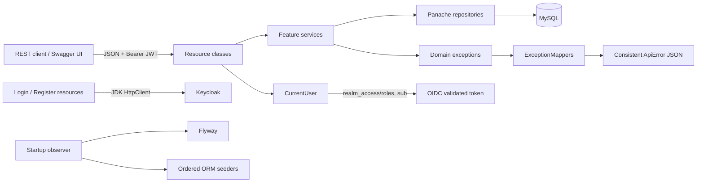

# Architecture overview

## Purpose and shape

Prompt Library is a small backend-only REST API for storing and organizing user prompts. It demonstrates a conventional layered Quarkus architecture without introducing a separate frontend, message bus, or microservice boundary. HTTP resources stay thin; services own business rules and transaction boundaries; Panache repositories own database access; Flyway owns schema changes; Keycloak owns users and the security authority.

## Feature areas

| Area | Responsibility |
|---|---|
| `prompt` | Store prompts with title/content, category, folder, favorite flag, owner, status, and tags; free-text search; move between folders |
| `category` | Global classifications for prompts, readable by all authenticated users, writable only by admins |
| `folder` | Owner-scoped folder trees, default root per user, nested creation, rename, move with cycle detection, non-empty deletion restrictions |
| `tag` | Owner-scoped names normalized to lowercase; list/search; create, rename, and delete only when not attached to prompts |
| `auth` | Login against Keycloak using the token endpoint and registration through Keycloak's Admin API |
| `security` | Extract the authenticated identity from JWT/security identity and expose `/api/me` |
| `common` | Entity/service base classes, exception types, and common JSON error mapping |
| `seed` | Ordered, idempotent development/demo seeders |

## Request flow: typical CRUD operation

1. Quarkus REST matches a `@Path` resource method. Class-level `@Authenticated` (or `@RolesAllowed("admin")` on category mutations) applies to protected methods; only auth login/register are `@PermitAll`.
2. The method accepts `@Valid` DTO input, forwarding it to a feature service. No business rule is implemented in the resource.
3. `CurrentUser` obtains identity data from the already validated token. It does not contact the DB or Keycloak.
4. The service resolves access rules. Normal users are confined to their own `owner_id`; admins bypass that visibility check. Resource-specific invariants (folder owner equality, cycle restrictions, reserved default folder, or usage checks) are evaluated inside `@Transactional`.
5. Repositories access MySQL using Panache. Entities are converted to DTO records within the same transaction, which is essential because lazy relations must be initialized before mapping.
6. `ResourceNotFoundException`, `ConflictException`, `InvalidCredentialsException`, and `UpstreamException` travel through `ExceptionMappers` and become structured JSON with codes `NOT_FOUND`, `CONFLICT`, `INVALID_CREDENTIALS`, or `KEYCLOAK_ERROR`. Bean Validation failures are handled by Quarkus itself as 400.

## Authentication and registration are separate call paths

OIDC resource-server validation handles bearer tokens in normal requests; no frontend redirect/session exists. Separately:

- **Login:** `POST /api/auth/login` calls Keycloak's `protocol/openid-connect/token` endpoint using the password grant and returns the token response. This is intended for learning/scripts; browser/native clients should normally use authorization code + PKCE directly with Keycloak.
- **Registration:** `POST /api/auth/register` obtains a service-account token with client_credentials and sends the new user's representation to `/admin/realms/{realm}/users`. It returns the newly created Keycloak user ID from the `Location` header.
- **Current user:** `GET /api/me` uses token claims (`sub`, `preferred_username`, `email`, and `realm_access/roles`).

The login client and registration client are independently configurable (`app.keycloak.client-*` and `app.keycloak.register-client-*`), but they default to the same `prompt-library-api` client. Their credentials must match the realm and client actually configured in Keycloak.

## Startup flow

1. SmallRye application configuration and the selected profile initialize the datasource/OIDC extension.
2. Flyway validates and applies new migrations, never rewriting the schema through Hibernate.
3. The startup observer in `DatabaseSeeder` checks `app.seed.enabled` and runs discovered `Seeder` beans in `order()` ascending order: categories → folders → tags → prompts.
4. Local Keycloak imports the bundled realm on its first startup; unlike the MySQL volume, its container does not retain realm data between Compose down/up cycles.

## Design constraints worth preserving

- Transactions remain in services; lazy associations are not serialized directly from controllers.
- Prompt/tag/folder accesses return **404 rather than 403** on foreign-owned objects so IDs cannot be enumerated.
- Cross-owner prompt-folder assignment and cross-owner folder parenting are forbidden even for admins; admin access changes visibility, not tenant consistency.
- Database identifiers (`BIGINT AUTO_INCREMENT`) and ownership (`Keycloak UUID strings`) are separate keys. There is intentionally no users table.
- New schema changes are Flyway migrations only, never an ad-hoc Hibernate schema update.
- Avoid performing lazy mapping in resources: query/fetch and DTO conversion belong inside service transaction boundaries.
