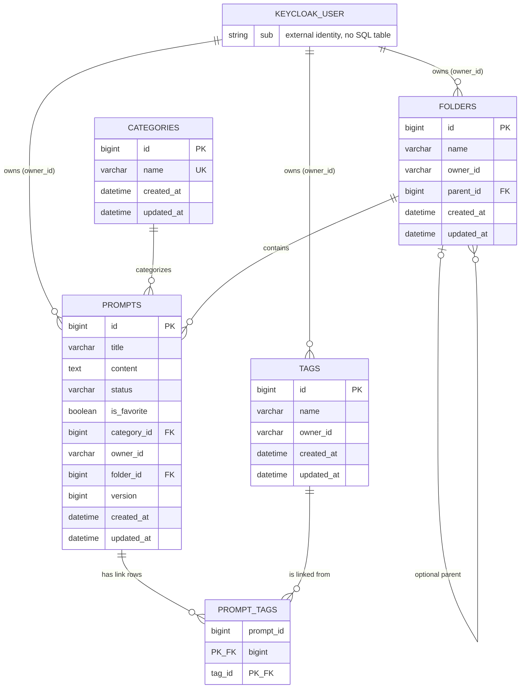

# Simplified ER diagram (presentation)

The diagram shows the important collections and ownership boundaries. `folders.parent_id` is a self-reference, so a tree can have any depth. Users are Keycloak accounts and are deliberately **not** modeled as a database table.

Multiplicities:

- One category can classify many prompts; every prompt has exactly one category.
- One folder can contain many prompts and many child folders. The parent is optional at the root.
- A prompt belongs to one folder, and every prompt belongs to exactly one owner (`owner_id`).
- Tags and prompts are linked through the join table `prompt_tags`. That is the only n:m relationship.
- `KEYCLOAK_USER` is shown for comprehension only; `owner_id` is a plain string with no database foreign key.

For exact SQL types, indexes and uniqueness rules see [schema.dbml](schema.dbml) and [database.md](README.md).
