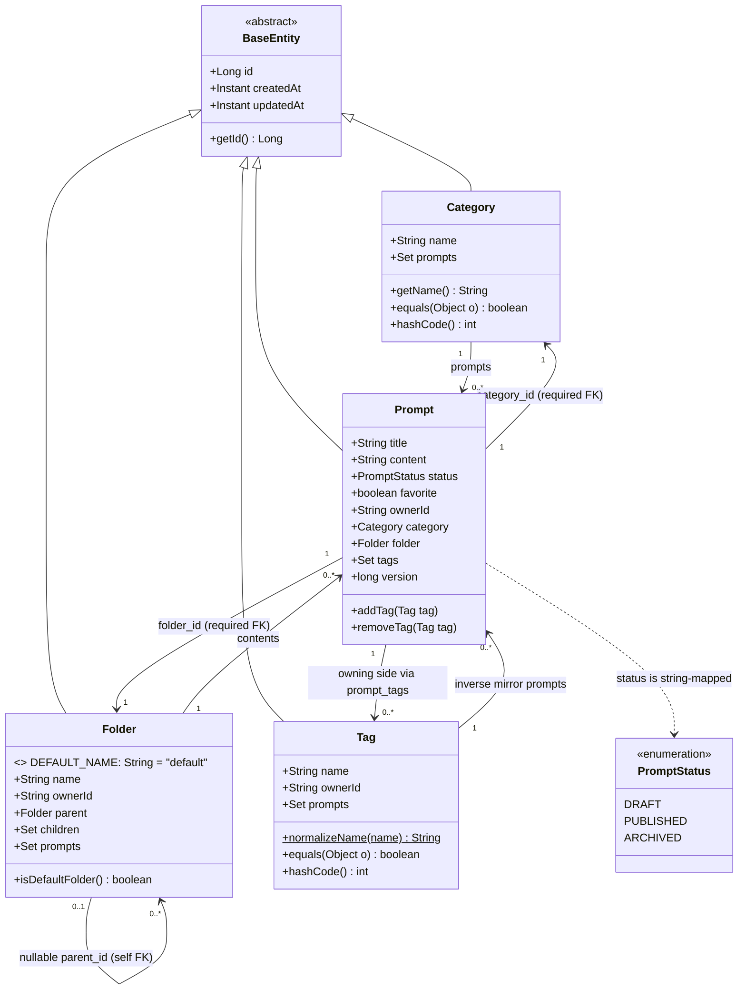
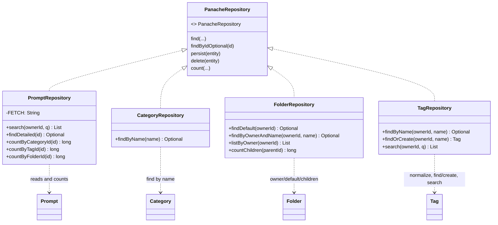

# UML: persistence model and repositories

## JPA domain classes

### Cardinality and ownership details

- `BaseEntity` defines database ID (IDENTITY/AUTO_INCREMENT) and timestamps; it is not a user model.
- `Prompt.ownerId` is the Keycloak subject, a string, not an association to an application `User` entity.
- `Prompt.folder ↔ Folder.prompts` is the required **N:1 folder organization** relationship. `Prompt.category ↔ Category.prompts` is the required **N:1 classification** relationship and is global (not user-owned).
- `Prompt.tags ↔ Tag.prompts` is the N:M relation stored in `prompt_tags` with `(prompt_id, tag_id)` PK and both delete cascades. The entity only writes the Prompt side; the Tag side is a read-only mirror.
- `Folder.parent` is nullable self-reference. `children` is the inverse 1:N mapping. Trees are traversed and constrained by `FolderService`, not by cascade rules.
- `PromptStatus` is stored with `EnumType.STRING`, so enum reordering is safe for existing DB values.

## Repository UML by type

### Repository notes

- Database access is type-safe and route-independent. `PanacheRepository` is an external Quarkus Panache type shown only to explain implemented contracts.
- `PromptRepository.search` dynamically adds `ownerId` and the optional q pattern via bound parameters. `findDetailed` uses FETCH loading of category/folder/tags.
- `CategoryRepository` and `FolderRepository` key lookups include owner or name. The default folder query specifically requires `name = "default" AND parent IS NULL`.
- Specialized find/create semantics for tags uses normalized name first (`trim().toLowerCase(Locale.ROOT)`), then per-owner lookup, not a process-global name.
