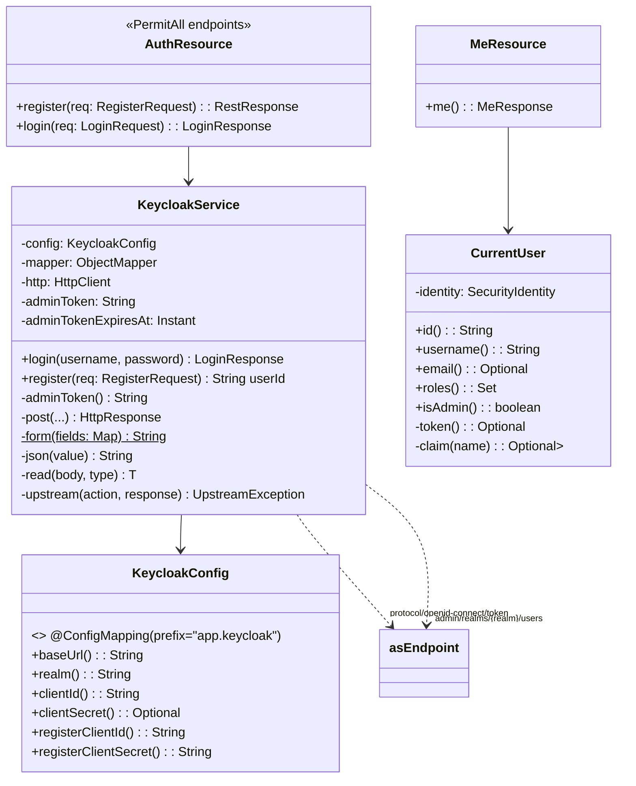
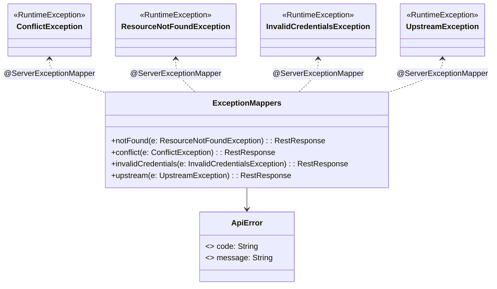
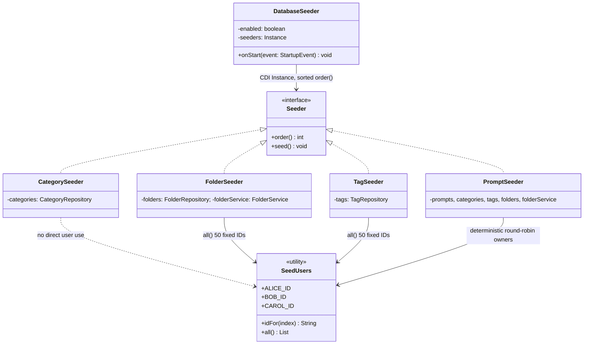

# UML: integration, data transfer, errors, and seeders

## Authentication & identity integration

## Request/response DTO records

These are transport-boundary records, not database entities.

| Package / group | Record | Components / validation |
|---|---|---|
| Auth | `LoginRequest` | username, password (`@NotBlank`) |
| Auth | `LoginResponse` | accessToken, refreshToken, expiresIn, tokenType |
| Auth | `RegisterRequest` | username 3–50, email valid/NotBlank, password ≥ 8, firstName and lastName required (Keycloak 24+) |
| Auth | `RegisterResponse` | userId, username |
| Security | `MeResponse` | id, username, email, roles |
| Prompt | `PromptRequest` | title ≤200, content ≤20k, categoryId not null positive, optional positive folderId, optional status/favorite, max 20 strings tags |
| Prompt | `PromptResponse` | id, title, content, status, favorite, categoryId/name, folderId/name, tags sorted, ownerId, createdAt, updatedAt |
| Prompt | `PromptMoveRequest` | required positive folderId |
| Folder | `FolderRequest` | name ≤100, optional positive parentId (null = root) |
| Folder | `FolderResponse` | id, name, ownerId, nullable parentId, isDefault (derived root + `"default"`) |
| Folder | `FolderUpdateRequest` | name ≤100 (`@NotBlank`) |
| Folder | `FolderMoveRequest` | optional positive parentId (null = root) |
| Category | `CategoryRequest` | name ≤100 (`@NotBlank`) |
| Category | `CategoryResponse` | id, name; `from(Category)` maps entity inside service transaction |
| Tag | `TagRequest` | name ≤50 (`@NotBlank`) |
| Tag | `TagResponse` | id, name, ownerId; `from(Tag)` maps entity + current owner id |
| Common | `ApiError` | machine `code` and human-readable `message` |

## Error mapping

Status map: not found=404, conflict=409, invalid credentials=401, upstream=502. Bean-validation failures are generated by Quarkus and are not handled in this mapper.

## Seeder architecture

Status and invocation details:

- `DatabaseSeeder` receives `StartupEvent` and `Instance<Seeder>` injection. If `app.seed.enabled` is false it returns immediately; otherwise it logs each type then invokes it in `order()` ascending sequence.
- `Seeder.order()` values 10, 15, 20, 30 are dependencies for startup data flow: categories → folders → tags → prompts.
- There is no `UserSeeder`. Users belong to the imported Keycloak realm whose 50 IDs `SeedUsers.idFor()` generates and reuses throughout seeding.
