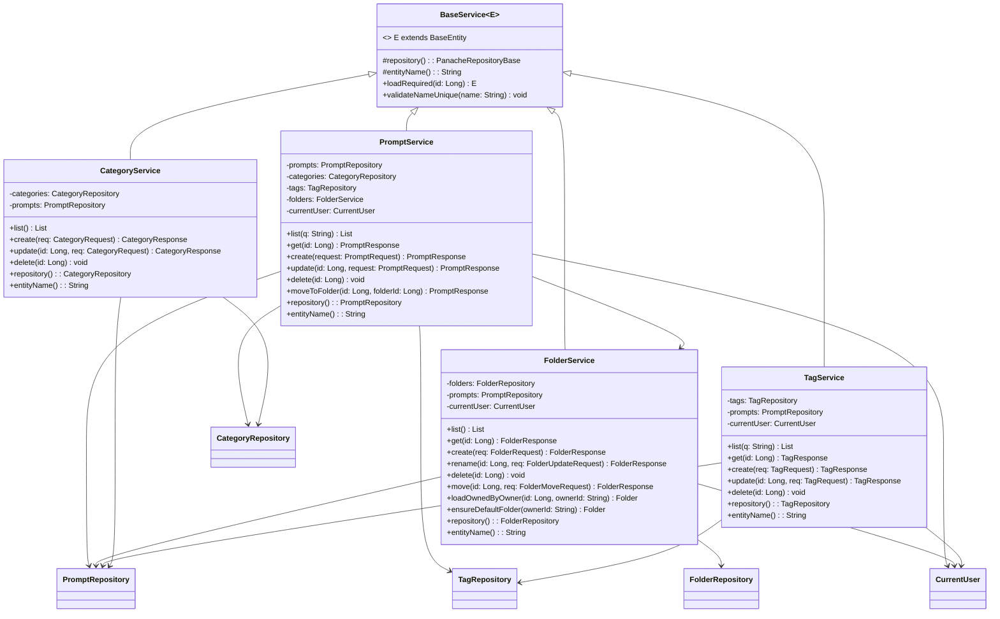
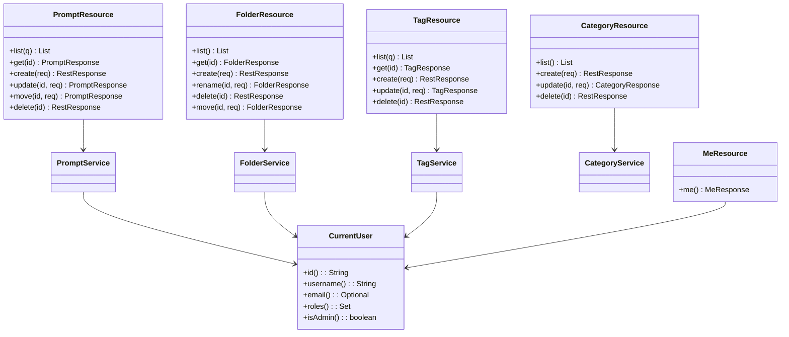

# UML: application services and REST boundaries

## Shared service base and feature implementations

### Dependency semantics

- `PromptService` is the coordinator. Category and folder pointers are resolved through their repositories/helpers; `FolderService` is a coordinator of trees and shared default-folder behavior. Record conversion happens inside `@Transactional`.
- `FolderService` uses `PromptRepository` only for count-based in-use checks (not for accessing HTTP resources). Folder trees are scoped by `ownerId`; the helper `loadOwnedByOwner` is used by prompt placement so an admin cannot accidentally attach a prompt to another owner's tree.
- `TagService` mirrors usage checks through `PromptRepository`; global admin bypass does not make tag names globally unique (owner ID remains unique per owner).
- `CategoryService` uses the globally unique name validator from `BaseService` and a count by category before deletion. Its logical differentiation from owner-scoped services should remain in the service methods, not in `BaseService`.

## Resource-to-service contracts

### REST rule map

- All resources shown are `@Authenticated`; category mutation methods also have `@RolesAllowed("admin")`.
- Creation methods construct HTTP 201 and `Location` in the resource; other responses are direct records or status-only results.
- No resource calls a repository or reads JPA fields directly. `CurrentUser` is constructed/inherited only where needed for scope.
- `MeResource` is the thin identity endpoint and delegates to `CurrentUser`. Login/register is a separate resource shown in [integration.md](integration.md).
